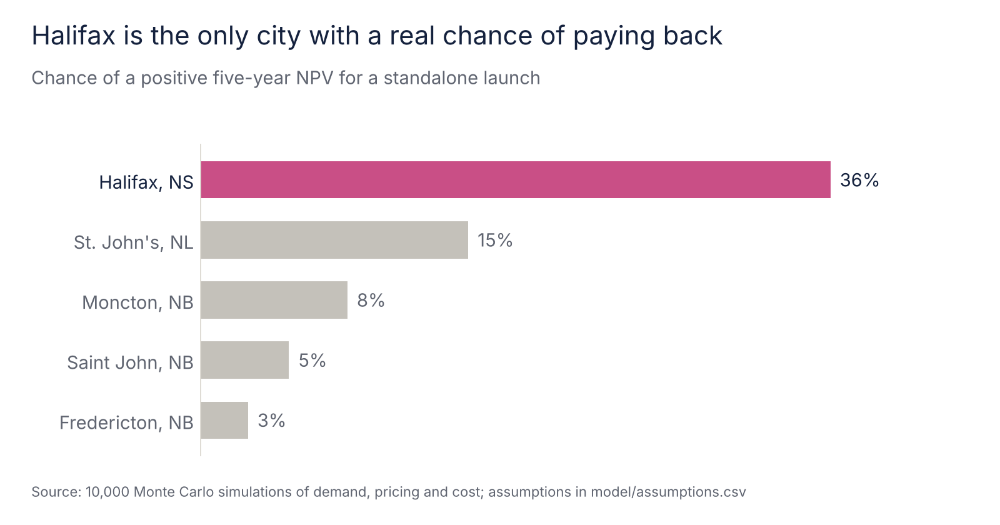
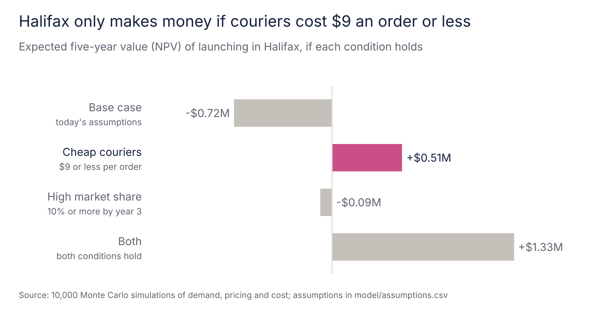

# Market Entry Investment Case: Should a Delivery Platform Launch in Atlantic Canada?

**[Try the live app](https://ekene-market-entry.streamlit.app/)**: change the assumptions and see the results update.

A five-year investment case for launching a food delivery platform in Atlantic Canada's five largest cities. It sizes each market from public data, builds city-level unit economics, runs 10,000 Monte Carlo simulations to show the range of outcomes, and identifies what has to be true for the launch to pay back.

Built in **Python** (NumPy, pandas). Every assumption lives in one editable file, [`model/assumptions.csv`](model/assumptions.csv), with a low, most likely and high value and its basis.

## The decision

A delivery platform is considering entering Halifax, St. John's, Moncton, Saint John and Fredericton (about 1.08 million people in total). **Which cities, if any, should it launch, and what must be true for the investment to pay back?**

## The recommendation

**Do not launch across the region. Launch Halifax only, and only once courier cost can be held at about $9 per order or less.**

- **Halifax is the only city with a real chance of paying back:** 36% chance of a positive five-year NPV on a standalone basis, against 15% or less for the other four
- **Under today's assumptions, even Halifax is a losing bet on average:** expected NPV is -$0.72M. The most likely case looks better (+$0.35M), but cost risks are lopsided: courier cost can rise much further above plan than it can fall below it
- **Courier efficiency is the swing factor:** in the simulations where courier cost is $9 per order or less, Halifax's expected NPV turns to **+$0.51M** (53% chance of a positive NPV). Add a market share of 10% or more and it rises to **+$1.33M** (68%)
- **Market share alone is not enough:** reaching 10% share without efficient courier operations still leaves expected NPV slightly negative (-$0.09M)
- **Break-even share is 9.4%** of local delivery orders by year 3 at the most likely values of every other input
- **Sharing one operations team across the three New Brunswick cities helps but does not rescue them:** every plan that adds cities to Halifax lowers expected NPV

The courier cost range comes from the companion [marketplace supply simulation](https://github.com/ekene-ok/marketplace-supply-simulation): a demand-shaped courier schedule costs about $8.18 per order at the minimum, or $8.79 with the buffer the simulation recommends against forecast error, while a flat schedule costs $12.70. Both shaped figures clear the $9 bar. In other words, the operating model decides the investment case.

## Try it yourself

**Live app: [ekene-market-entry.streamlit.app](https://ekene-market-entry.streamlit.app/)**

An interactive version ([`app.py`](app.py)) lets you change the key assumptions (market share, courier cost, commission, fees, order frequency and marketing spend), pick which cities to launch, and see the chance of paying back update instantly. To run it locally:

```bash
pip install -r requirements.txt
streamlit run app.py
```

## Charts





## Results

### By city (standalone launch, five-year NPV at a 10% discount rate)

| City | Population (2021) | Most likely NPV | Expected range (10th to 90th percentile) | Chance NPV is positive |
|---|---|---|---|---|
| Halifax, NS | 465,703 | +$0.35M | -$3.82M to +$2.75M | 36% |
| St. John's, NL | 212,579 | -$0.67M | -$2.66M to +$0.39M | 15% |
| Moncton, NB | 157,717 | -$0.89M | -$2.42M to -$0.12M | 8% |
| Saint John, NB | 130,613 | -$0.99M | -$2.31M to -$0.37M | 5% |
| Fredericton, NB | 108,610 | -$1.08M | -$2.21M to -$0.56M | 3% |

### By launch plan

| Plan | Expected NPV | Chance NPV is positive |
|---|---|---|
| **Halifax only** | **-$0.72M** | **36%** |
| Halifax + St. John's | -$1.94M | 27% |
| Halifax + New Brunswick cluster (shared team) | -$2.45M | 28% |
| All five, shared New Brunswick team | -$3.67M | 25% |
| All five, one team per city | -$6.08M | 15% |

### Halifax most likely case

| Year | Orders | Revenue | Contribution after variable costs | Marketing | Local team | Cash flow |
|---|---|---|---|---|---|---|
| 1 | 128,758 | $2.00M | $0.70M | $1.86M | $0.40M | -$1.57M |
| 2 | 241,420 | $3.74M | $1.30M | $0.93M | $0.40M | -$0.03M |
| 3 to 5 (each) | 321,894 | $4.99M | $1.74M | $0.47M | $0.40M | +$0.87M |

The most likely case pays back in year 4. Each order contributes about $5.40 after courier and other variable costs.

### What moves Halifax's NPV most (each input from low to high, others at most likely)

| Input | Range tested | NPV at low | NPV at high |
|---|---|---|---|
| Market share by year 3 | 5% to 20% | -$2.30M | +$5.63M |
| Courier cost per order | $7.50 to $12.70 | +$1.03M | -$4.06M |
| Merchant commission | 18% to 30% | -$2.26M | +$2.20M |
| Consumer fees per order | $4 to $8 | -$1.61M | +$2.30M |
| Orders per regular user per month | 2 to 4 | -$1.42M | +$2.11M |

Full results: [`results/sensitivity_tornado.csv`](results/sensitivity_tornado.csv).

## How the model works

For each city and year ([`model/investment_model.py`](model/investment_model.py)):

- **Orders** = population × adults × share who order regularly × orders per month × 12 × market share × ramp (40% of steady share in year 1, 75% in year 2, 100% from year 3)
- **Revenue per order** = order value × merchant commission + consumer fees
- **Variable cost per order** = courier cost + order value × other variable costs (payments, refunds, support)
- **Marketing** = launch spend per resident (full in year 1, half in year 2, a quarter after that)
- **Local team** = a fixed annual cost per city, or one shared team across the New Brunswick cities
- **NPV** = five annual cash flows discounted at 10%, with no terminal value (a conservative choice)

**Monte Carlo:** each of 10,000 simulations draws every input from a triangular distribution (low, most likely, high). Market-wide inputs are drawn once per simulation and shared by all cities, so city outcomes move together as they would in reality.

## Key inputs and sources

| Input | Low / most likely / high | Basis |
|---|---|---|
| City populations | Census values | [Statistics Canada, 2021 Census, census metropolitan areas](https://www150.statcan.gc.ca/n1/daily-quotidien/220209/t002a-eng.htm) |
| Share of adults ordering regularly | 18% / 24% / 30% | 27.4% of Canadians order through delivery apps more than once a month ([Dalhousie Agri-Food Analytics Lab survey, reported by Retail Insider, 2025](https://retail-insider.com/retail-insider/2025/09/food-delivery-apps-reshape-canadian-eating-habits/)); set lower for smaller cities |
| Orders per regular user per month | 2 / 3 / 4 | Third-party app users order about four times a month ([DoorDash merchant research](https://merchants.doordash.com/en-ca/blog/quebec-online-ordering-trends)) |
| Average order value | $32 / $38 / $45 | $32 average order ([Vividata, reported by Strategy, 2020](https://strategyonline.ca/?p=200790)), raised for food inflation |
| Courier cost per order | $7.50 / $8.20 / $12.70 | [Marketplace supply simulation](https://github.com/ekene-ok/marketplace-supply-simulation) |
| Market share, commission, fees, team and marketing costs | See assumptions file | Planning assumptions, clearly labelled |

## Repository structure

```
app.py                     interactive version (Streamlit)
model/
  assumptions.csv          every input with low, most likely, high and basis
  cities.csv               city populations
  investment_model.py      city cash flow model
scripts/
  run_model.py             base case, Monte Carlo, plans, what has to be true, sensitivity, break-even
  make_charts.py           README charts
results/                   all outputs as CSV
charts/                    README charts
```

## How to run it

```bash
pip install numpy pandas matplotlib
python scripts/run_model.py
python scripts/make_charts.py
```

Change any value in `model/assumptions.csv` and rerun to test your own view.

## Limitations

- **Competitors are not modelled explicitly.** Established platforms already operate in these cities; their response is folded into the market share range rather than simulated
- **Survey inputs are national, not Atlantic-specific.** Regular-user share and order frequency are adjusted down by judgment for smaller cities
- **No terminal value.** A business still running in year 5 has value beyond it, so NPVs here are conservative
- **Order value is from 2020.** It is adjusted for inflation by assumption, not by an indexed series

## Licence

MIT. Public data is cited above; all other inputs are labelled assumptions.
